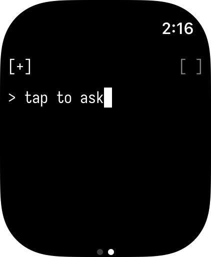
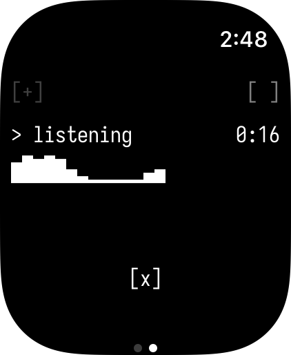
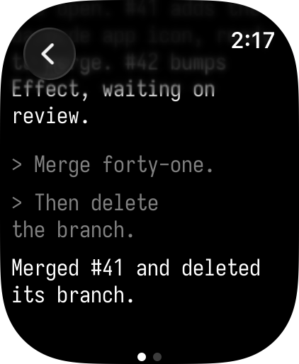
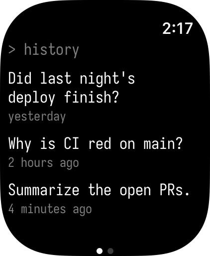

# Sideband

[](https://github.com/jstettner/Sideband/actions/workflows/ci.yml)

Push-to-talk for your AI agent, from an Apple Watch.

Press, speak, lower your wrist, feel the haptic, then read a short answer. Sideband is
a small native watchOS app, a backend that transcribes the audio and relays the turn,
and a runner that sits next to your agent. Hermes is the first agent and Aqua the
first transcription provider. Neither is built into the watch app.

<p align="center">
  
  
  
  
</p>

```text
watch ──POST /v1/turn──▶ backend ──▶ transcription provider
                            │
                            ▼  WebSocket (outbound from runner)
                          runner ──▶ agent (local)
```

## Layout

| Path                           | What                                                                                        |
| ------------------------------ | ------------------------------------------------------------------------------------------- |
| `packages/protocol/`           | The contract: HTTP API (watch ↔ backend), runner WebSocket protocol, shared Effect Schemas  |
| `packages/agents/`             | Agents a runner can drive: the `Agent` service, adapters (Echo, Hermes), their contract     |
| `packages/transcription/`      | Speech to text for backends: the `Transcription` service, WAV canonicalization, providers   |
| `watch/`                       | watchOS app + widgets (Swift/SwiftUI, project generated with XcodeGen)                      |
| `packages/backend-cloudflare/` | Reference backend: Cloudflare Worker + Relay Durable Object (Effect, deployed with Alchemy) |
| `packages/runner/`             | Long-lived process next to the agent (Bun + Effect)                                         |

Write your own backend or runner against `packages/protocol/`. `docs/architecture.md` shows how the pieces fit
and how a turn moves through the relay.

## Development

Requirements: [Bun](https://bun.sh) at the `packageManager` version in `package.json` (`bun upgrade`),
[Node](https://nodejs.org) 22+ (Vitest runs on it), Xcode, [XcodeGen](https://github.com/yonaskolb/XcodeGen).

```sh
bun install       # installs, patches TypeScript with @effect/tsgo, clones reference/, and installs git hooks
bun run check     # tsc -b: every package, with the Effect language service diagnostics
bun run lint      # oxlint + dprint check + the openapi.json check (dprint downloads its plugins on first run)
bun run test      # vitest run
bun run format    # dprint fmt
bun run openapi   # regenerate packages/protocol/openapi.json
bun run dev       # the backend on local workerd (alchemy dev, stage dev_$USER), at http://localhost:1337
```

`bun run test` includes the backend's Workers tests, which deploy the stack to local workerd (stage
`test_$USER`) and run the real runner against it. Neither `dev` nor the tests need a Cloudflare account.
Point a local runner at the dev backend with `SIDEBAND_BACKEND_URL=ws://localhost:1337`.

The pre-commit hook (`.githooks/pre-commit`, enabled by `bun install` through `core.hooksPath`) runs
`check`, `lint`, and `test`.

Editor: install the TypeScript 7 (native) extension. `.vscode/settings.json` points it at the
workspace TypeScript so Effect diagnostics show up.

`reference/` holds read-only clones of upstream source (Effect and Alchemy, at the tags matching the
root catalog) for agents to read; `AGENTS.md` explains them. `bun install` warns and
carries on if it can't reach GitHub to sync them; `bun run reference:sync` retries and fails loudly.
Under `CI`, the sync is skipped.

Local config is never committed. Copy the `*.example` files:

- `packages/backend-cloudflare/.env.example` (the tokens and Aqua key `bun run dev` binds)
- `packages/backend-cloudflare/.env.prod.example` (the same for prod, read by `bun run deploy`)
- `packages/runner/.env.example` (the runner's settings; `bun run runner:install` copies them)
- `watch/Config/Local.xcconfig.example`

## The runner

The runner runs on the agent's Mac as a launchd agent. From the repo, with `packages/runner/.env` filled in:

```sh
bun run runner:install           # build, then install (or reinstall) and start the agent
sideband-runner status           # loaded? running? last exit code, installed version
sideband-runner logs -f          # follow its log
sideband-runner restart
sideband-runner uninstall        # --purge also deletes its settings and log
```

`install` checks the settings before touching anything, so a broken configuration never becomes a crash loop.
Everything lives at stable paths, so moving or rebuilding the repo can't break the agent:

| What     | Where                                              |
| -------- | -------------------------------------------------- |
| binary   | `~/.local/bin/sideband-runner` (a copy)            |
| settings | `~/.config/sideband/runner.env` (mode 0600)        |
| log      | `~/Library/Logs/sideband/runner.log`               |
| agent    | `~/Library/LaunchAgents/com.sideband.runner.plist` |

Put `~/.local/bin` on your `PATH` for the `sideband-runner` commands. The first `install` copies
`packages/runner/.env` to the settings file; after that, edit the settings file and
`sideband-runner restart`. launchd restarts the runner after a crash but not after a clean exit, which means
another runner replaced it. In the repo, `bun run --cwd packages/runner start` runs it in the foreground with
`packages/runner/.env`.

## Stages and deploying

The backend is an [Alchemy](https://alchemy.run) stack (`packages/backend-cloudflare/alchemy.run.ts`) with
three kinds of stage:

| Stage        | What                             | State                                    |
| ------------ | -------------------------------- | ---------------------------------------- |
| `dev_$USER`  | `bun run dev`: local workerd     | `.alchemy/` in the package, on your disk |
| `test_$USER` | the Workers tests: local workerd | `.alchemy/` in the package, on your disk |
| `prod`       | the only deployed stage          | `Cloudflare.state()`, in your account    |

There is no staging stage. Any other stage fails before anything is planned.

To deploy prod:

1. Connect Alchemy to Sideband's Cloudflare account once, in a profile of its own, `sideband`, which
   `bun run deploy` always uses (so it never deploys with another project's `default` profile):
   ```sh
   cd packages/backend-cloudflare
   bunx alchemy profile create sideband
   bunx alchemy profile edit --add Cloudflare --profile sideband
   bunx alchemy profile show --profile sideband
   ```
   Pick Sideband's account when Cloudflare asks, and check the `accountId` that `show` prints. Run the Alchemy
   CLI from that package, where it is installed: from the repo root, `bunx` fetches a separate copy that can't
   load its `@effect/platform-bun` peer. Profiles live in `~/.alchemy/`, so they work from any checkout.
2. Copy `packages/backend-cloudflare/.env.prod.example` to `.env.prod` beside it, and fill in the tokens the
   watch and the runner use, and the Aqua key. The Worker binds each as a secret on every deploy.
3. `bun run deploy`. It shows the plan and asks before applying it.

The prod Worker's script is `sideband`, so its URL is `https://sideband.<subdomain>.workers.dev`. The Relay
migrates its own SQLite when it activates; a deploy needs no migration step.

## License

MIT
